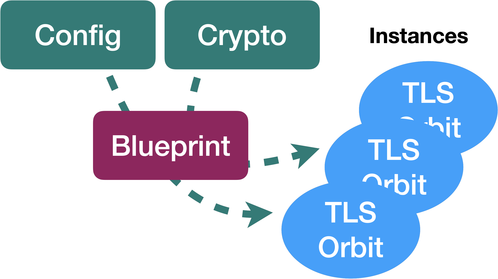

# yaws TLS Orbits

This repository consists of the [Blueprint] & [Orbit] implementations of Transport Layer Security (TLS) part of YAWS to provide the de-coupled [sans-io] networking stack.



## Options

The below options are wired up:

| Suite  | Requires std? | Requires alloc? | BYO CryptoRng | BYO Crypto         |
| :---   | :---          | :---            | :---          | :---               |
| [rustls] | opt-in        | yes             | no            | yes                |
| [yTLS]   | no            | no              | yes           | yes                |

## Validation

Testing and validation is done against OpenSSL

Please generate p256v1 certs before running cargo test:

```ignore
cd test_certs; make prime256v1
```

## Usage

Typically these Orbits are used and configured through YAWS runtimes.

To use them, see examples from the [test_ab](./test_ab) sources.

### License

This project is licensed under either of

 * Apache License, Version 2.0, ([LICENSE-APACHE](LICENSE-APACHE) or
   http://www.apache.org/licenses/LICENSE-2.0)
 * MIT license ([LICENSE-MIT](LICENSE-MIT) or
   http://opensource.org/licenses/MIT)

at your option.

### Contribution

Unless you explicitly state otherwise, any contribution intentionally submitted
for inclusion by you, as defined in the Apache-2.0 license, shall be dual
licensed as above, without any additional terms or conditions.

[rustls]: ./rustls-blueprint
[ytls]: ./ytls-blueprint
[Blueprint]: https://yaws-rs.github.io/book/traits/blueprint.html
[Orbit]: https://yaws-rs.github.io/book/traits/orbit.html
[sans-io]: https://yaws-rs.github.io/book/traits/overview.html
